<div align="center">

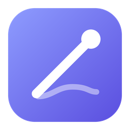

# Baton

**สั่งงาน Claude Code หลายตัวพร้อมกัน แต่ละตัวมี branch และโฟลเดอร์ของตัวเอง · ดู diff · เปิด PR · ทดสอบด้วย Spotlight**<br>
**Run a team of Claude Code agents in parallel, each on its own branch and folder · review diffs · open PRs · test with Spotlight**

-000000?logo=apple&logoColor=white)


[ภาษาไทย](#-ภาษาไทย) · [English](#-english)

<br>

<a href="https://github.com/madara1150/multi-tasker/releases/latest/download/Baton-macOS.dmg"></a>
&nbsp;
<a href="https://github.com/madara1150/multi-tasker/releases/latest/download/Baton-Windows-Setup.exe"></a>

<sub>Windows แบบไม่ต้องติดตั้ง / Portable: <a href="https://github.com/madara1150/multi-tasker/releases/latest/download/Baton-Windows-Portable.zip">Baton-Windows-Portable.zip</a> · ทุกเวอร์ชัน / All versions: <a href="https://github.com/madara1150/multi-tasker/releases">Releases</a></sub>

<br><br>

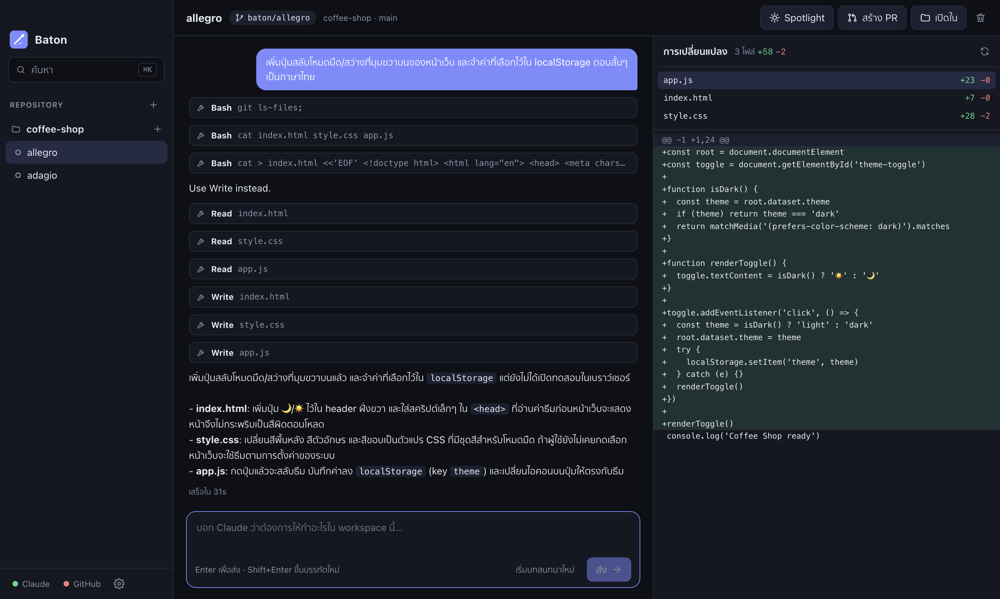

</div>

---

## 🇹🇭 ภาษาไทย

### ✨ ทำอะไรได้บ้าง

| ✨ ฟีเจอร์ | คำอธิบาย |
|---|---|
| 🧑‍🤝‍🧑 **หลาย agent พร้อมกัน** | สร้าง workspace ได้ไม่จำกัด แต่ละอันคือ git worktree + branch ของตัวเอง Claude แต่ละตัวจึงไม่แก้ไฟล์ทับกัน |
| 💬 **คุยกับ Claude ในแอป** | พิมพ์งานที่ต้องการ ดูว่า Claude อ่าน/แก้ไฟล์ไหนแบบสด กดหยุดได้ และคุยต่อจากเดิมได้ |
| 🔑 **ใช้บัญชี Claude ของคุณ** | ใช้ Claude Code ที่ติดตั้งในเครื่องและบัญชีที่ login ไว้ (Pro / Max / Team) แอปไม่เก็บรหัสผ่านหรือ token |
| 🐙 **เชื่อม GitHub** | login ด้วยรหัสครั้งเดียว เลือก clone repository จากรายการ และเปิด pull request ได้ในคลิกเดียว |
| 📁 **ตั้งค่า repository** | เลือก branch ตั้งต้น และ setup script (เช่น `npm install`) ที่จะรันในทุก workspace ใหม่ |
| 🔦 **Spotlight** | นำไฟล์ของ workspace ไปแสดงในโฟลเดอร์ repository หลัก เพื่อทดสอบกับ dev server, `node_modules` และ `.env` ที่มีอยู่แล้ว กดปิดแล้วทุกอย่างกลับเหมือนเดิม |
| 🔎 **ค้นหาแบบ Spotlight (⌘K)** | ช่องเดียวไปได้ทุกที่: สลับ workspace, สร้าง workspace, เปลี่ยนธีม, เปิด PR |
| 📝 **ดู diff** | เห็นทุกไฟล์ที่เปลี่ยนเทียบกับ branch ตั้งต้น ทั้งที่ commit แล้วและยังไม่ commit |
| 🎨 **ธีม** | 6 ธีม (มืด 4 สว่าง 2) หรือตามระบบ เลือกสีเน้นและขนาดตัวอักษรได้ |
| 🌏 **ไทย / อังกฤษ** | สลับภาษาได้ทันทีในหน้าตั้งค่า |

<p align="center">
  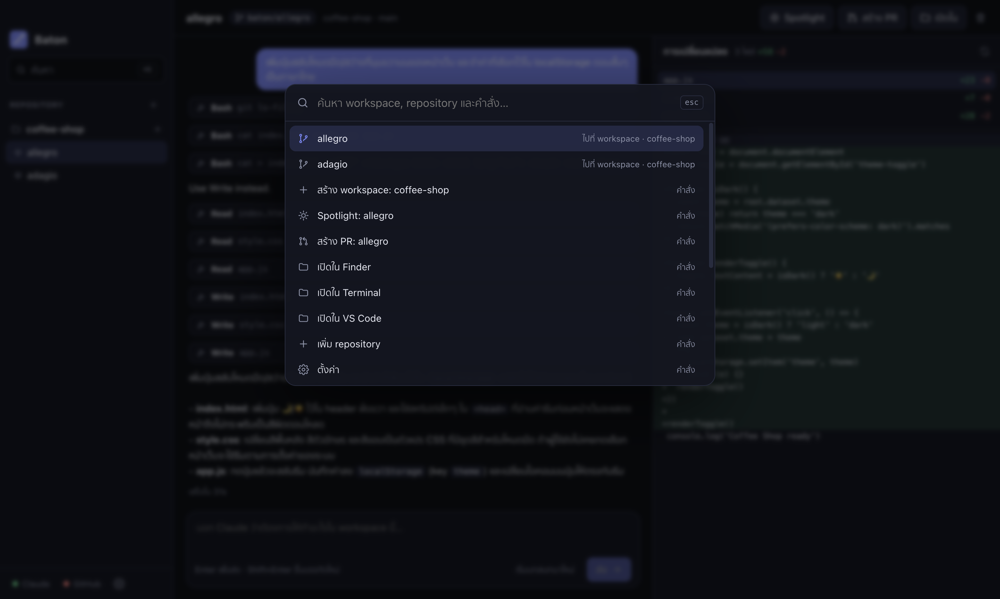
  <br><br>
  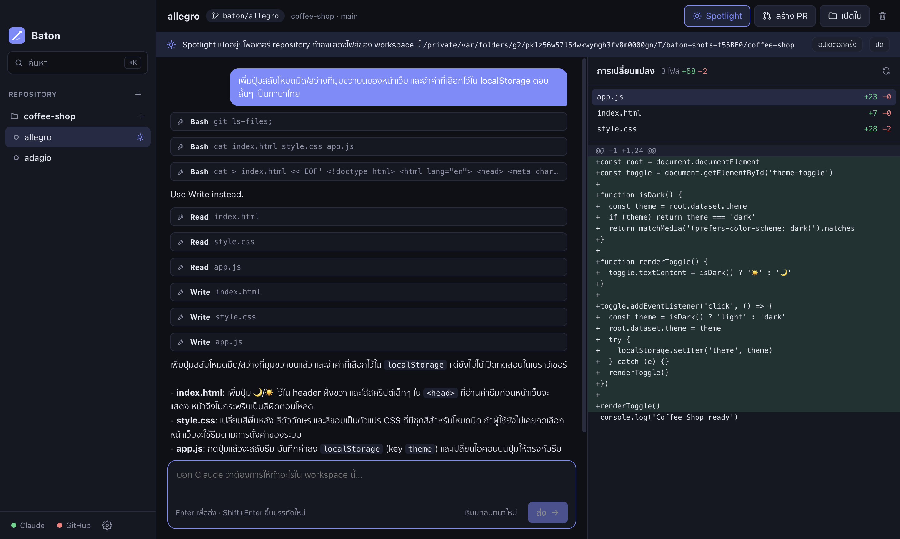
  <br><br>
  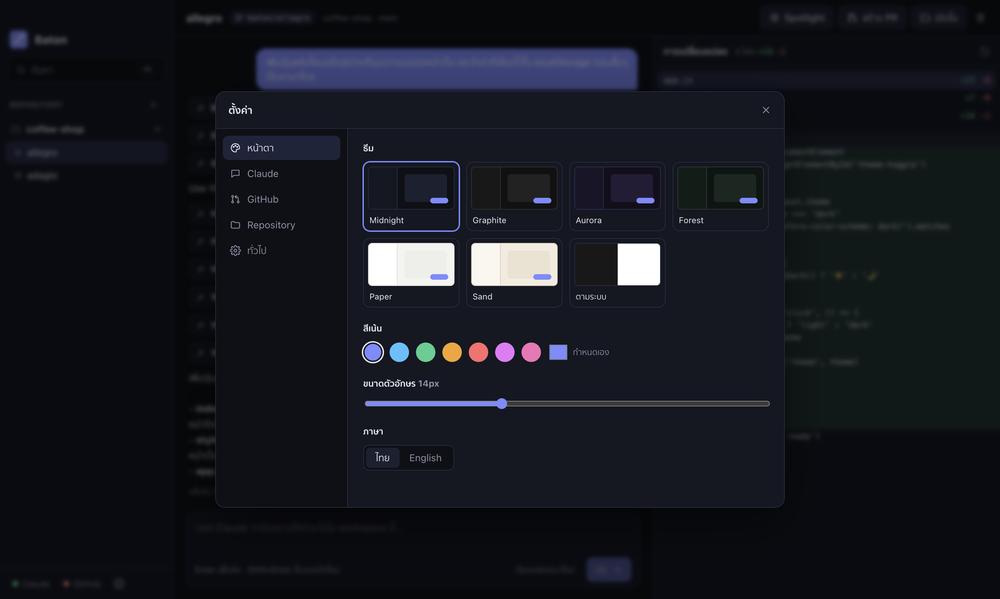
</p>

---

### 📥 ดาวน์โหลดและติดตั้ง

1. ติดตั้งสิ่งที่ต้องมีก่อน: [Git](https://git-scm.com), [Claude Code](https://claude.com/claude-code) และ [GitHub CLI](https://cli.github.com) (`gh`)
2. ดาวน์โหลด Baton จากปุ่มด้านบน
   - **macOS**: เปิด `Baton-macOS.dmg` แล้วลาก Baton ไปที่ Applications
   - **Windows**: เปิด `Baton-Windows-Setup.exe` หรือแตกไฟล์ Portable แล้วเปิด `Baton.exe`

---

### 🚀 วิธีใช้

1. **เข้าสู่ระบบ Claude** กดปุ่ม "เข้าสู่ระบบ" ในหน้าแรก (ถ้า login Claude Code ไว้แล้วจะขึ้นเครื่องหมายถูกเอง)
2. **เชื่อม GitHub** กด "เชื่อมต่อ" แอปจะแสดงรหัส ให้คัดลอกไปวางในหน้า GitHub ที่เปิดขึ้นมา
3. **เพิ่ม repository** เลือกโฟลเดอร์ในเครื่อง หรือ clone จากรายการ GitHub
4. **สร้าง workspace** ตั้งชื่อ (หรือปล่อยให้สุ่ม) และเลือก branch ตั้งต้น
5. **สั่งงาน** พิมพ์สิ่งที่ต้องการแล้วกด Enter สร้าง workspace เพิ่มเพื่อให้หลายงานเดินพร้อมกันได้
6. **ทดสอบด้วย Spotlight** กดปุ่ม Spotlight แล้วทดสอบในโฟลเดอร์ repository หลัก เสร็จแล้วกด "ปิด"
7. **เปิด PR** กด "สร้าง PR" ใส่หัวข้อ แอปจะ commit, push และเปิด pull request ให้

<p align="center">
  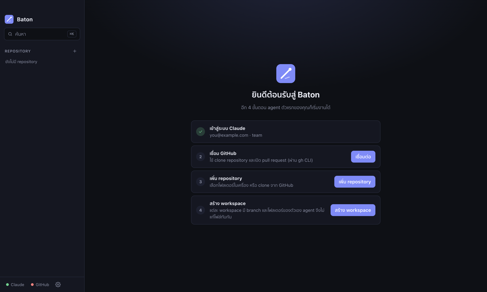
</p>

---

### ❓ คำถามที่พบบ่อย

**macOS แจ้งว่าเปิดไม่ได้เพราะไม่รู้จักผู้พัฒนา** — คลิกขวาที่ Baton เลือก Open แล้วกด Open อีกครั้ง หรือไปที่ System Settings → Privacy & Security แล้วกด Open Anyway

**Windows SmartScreen ขึ้นเตือน** — กด More info แล้วกด Run anyway

**Claude ไม่ยอมรันคำสั่ง (เช่น test หรือ npm install)** — ค่าเริ่มต้นอนุญาตเฉพาะการแก้ไฟล์ เปลี่ยนได้ที่ ตั้งค่า → Claude → "ทุกอย่าง" (ใช้กับ repository ที่ไว้ใจเท่านั้น)

**Spotlight แจ้งว่าโฟลเดอร์ repository มีไฟล์ที่แก้ค้างไว้** — Baton จะไม่แตะโฟลเดอร์ที่มีงานค้าง ให้ commit หรือ stash ก่อน

**ไฟล์ของฉันถูกส่งไปไหนบ้าง** — โค้ดอยู่ในเครื่องคุณ Baton เรียก Claude Code และ `gh` ในเครื่องเท่านั้น ข้อมูลจะออกจากเครื่องตามการทำงานปกติของสองโปรแกรมนั้น (ส่งให้ Claude และ GitHub)

**workspace เก็บไว้ที่ไหน** — `~/Baton/workspaces/<repo>/<ชื่อ>` เปลี่ยนได้ที่ ตั้งค่า → ทั่วไป

---

### 🛠️ build เอง (สำหรับนักพัฒนา)

```bash
npm install
npm run dev          # เปิดแอปแบบ hot reload
npm test             # ทดสอบ git / Spotlight
npm run typecheck
./build_mac.sh       # → dist/Baton-macOS.dmg
build_windows.bat    # → dist/Baton-Windows-Setup.exe, dist/Baton-Windows-Portable.zip
npm run screenshots  # ถ่ายภาพ README ใหม่จากแอปจริง
```

โครงสร้าง: `src/main` (Electron: git, GitHub, Claude) · `src/renderer` (React UI) · `src/shared` (types) · `tests` · `tools`

### 📄 License

[MIT](LICENSE) © 2026 Tanathip

---

## 🇬🇧 English

### ✨ What it does

| ✨ Feature | Description |
|---|---|
| 🧑‍🤝‍🧑 **Many agents at once** | Create as many workspaces as you like. Each is its own git worktree and branch, so agents never overwrite each other. |
| 💬 **Chat with Claude in the app** | Describe a task, watch which files Claude reads and edits live, stop it any time and pick the conversation back up later. |
| 🔑 **Your own Claude account** | Uses the Claude Code installed on your computer and the account signed in there (Pro / Max / Team). Baton stores no password or token. |
| 🐙 **GitHub built in** | Sign in with a one-time code, clone from your repository list and open a pull request in one click. |
| 📁 **Per-repository settings** | Choose the base branch and a setup script (for example `npm install`) that runs in every new workspace. |
| 🔦 **Spotlight** | Show a workspace's files in the main repository folder to test them with the dev server, `node_modules` and `.env` already there. Turn it off and everything is back as it was. |
| 🔎 **Spotlight-style search (⌘K)** | One box for everything: switch workspace, create one, change theme, open a PR. |
| 📝 **Diff view** | Every file changed against the base branch, committed or not. |
| 🎨 **Themes** | Six themes (four dark, two light) or match the system, plus accent colour and text size. |
| 🌏 **Thai / English** | Switch language instantly in Settings. |

<p align="center">
  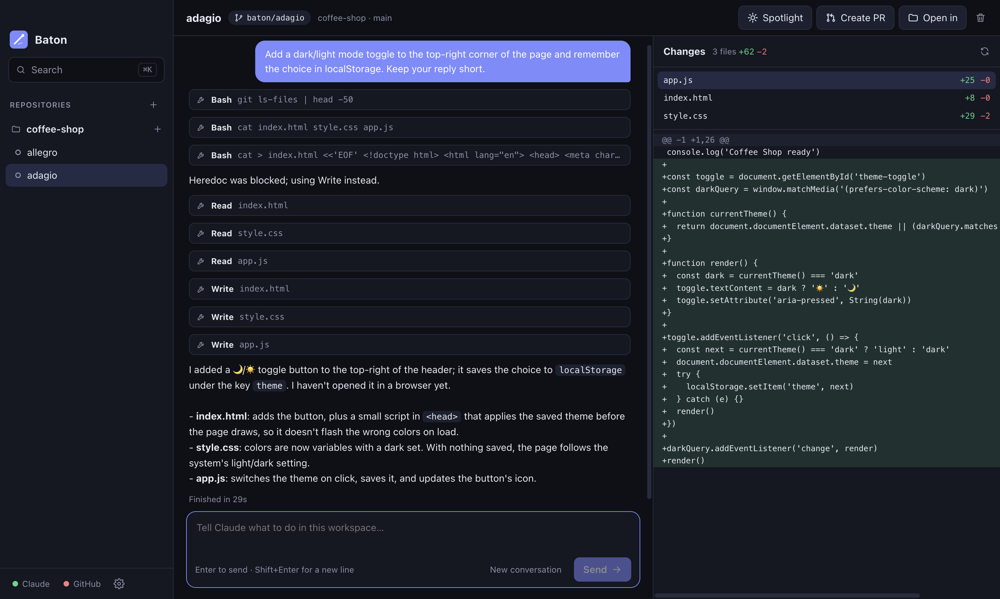
  <br><br>
  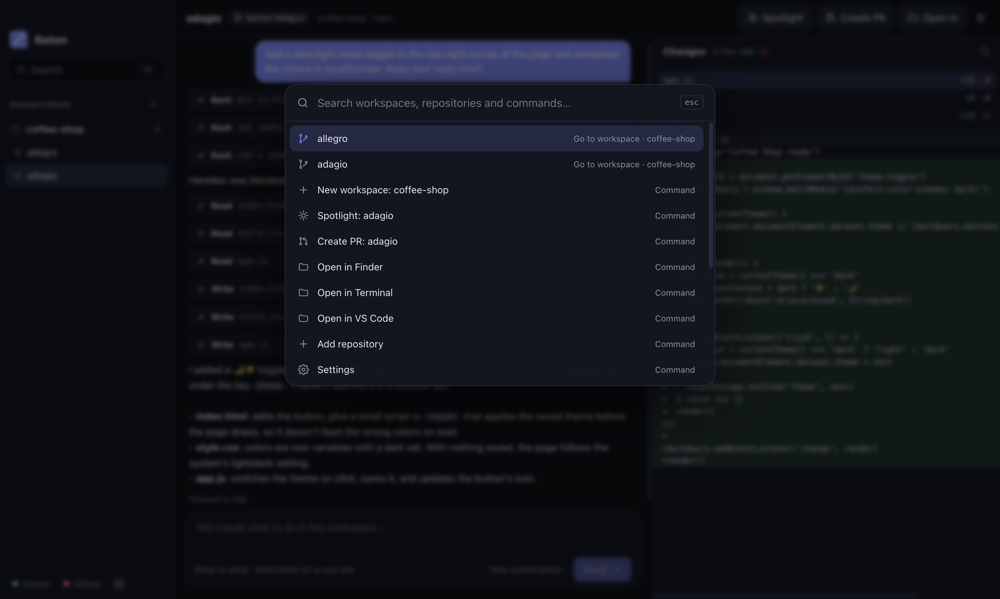
  <br><br>
  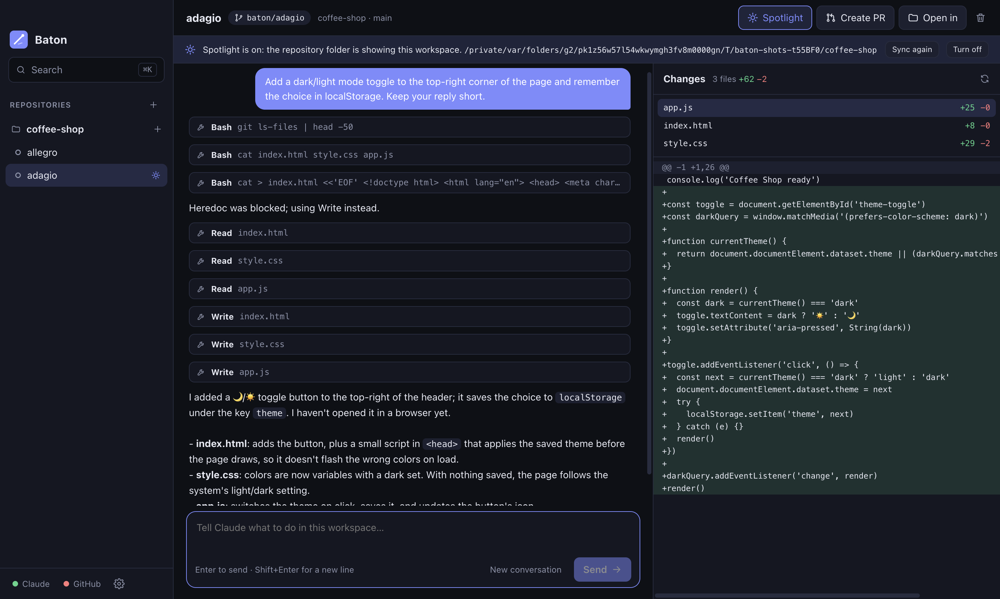
  <br><br>
  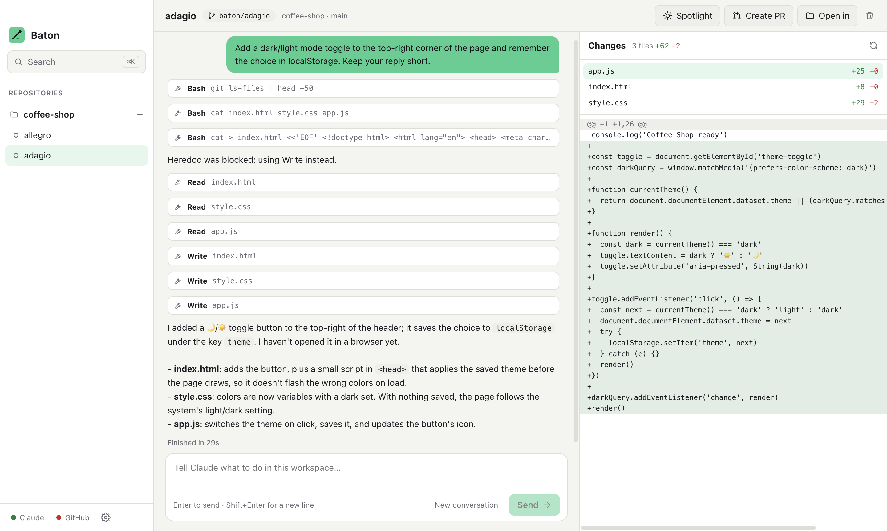
</p>

---

### 📥 Download and install

1. Install the prerequisites: [Git](https://git-scm.com), [Claude Code](https://claude.com/claude-code) and the [GitHub CLI](https://cli.github.com) (`gh`).
2. Download Baton with the buttons at the top.
   - **macOS**: open `Baton-macOS.dmg` and drag Baton to Applications.
   - **Windows**: run `Baton-Windows-Setup.exe`, or unzip the portable build and run `Baton.exe`.

---

### 🚀 How to use

1. **Sign in to Claude.** Press "Sign in" on the welcome screen (already signed in to Claude Code? It is ticked for you).
2. **Connect GitHub.** Press "Connect", copy the code Baton shows and paste it on the GitHub page that opens.
3. **Add a repository.** Pick a folder on your computer or clone one from your GitHub list.
4. **Create a workspace.** Name it (or get a random name) and choose the branch to start from.
5. **Give it a task.** Type what you want and press Enter. Create more workspaces to run several tasks side by side.
6. **Test with Spotlight.** Press Spotlight, test in the main repository folder, then press "Turn off".
7. **Open a PR.** Press "Create PR" and enter a title. Baton commits, pushes and opens the pull request.

<p align="center">
  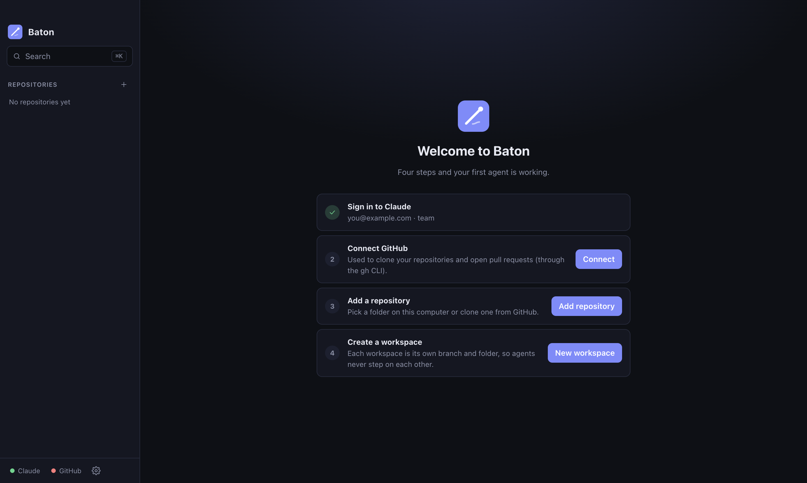
  <br><br>
  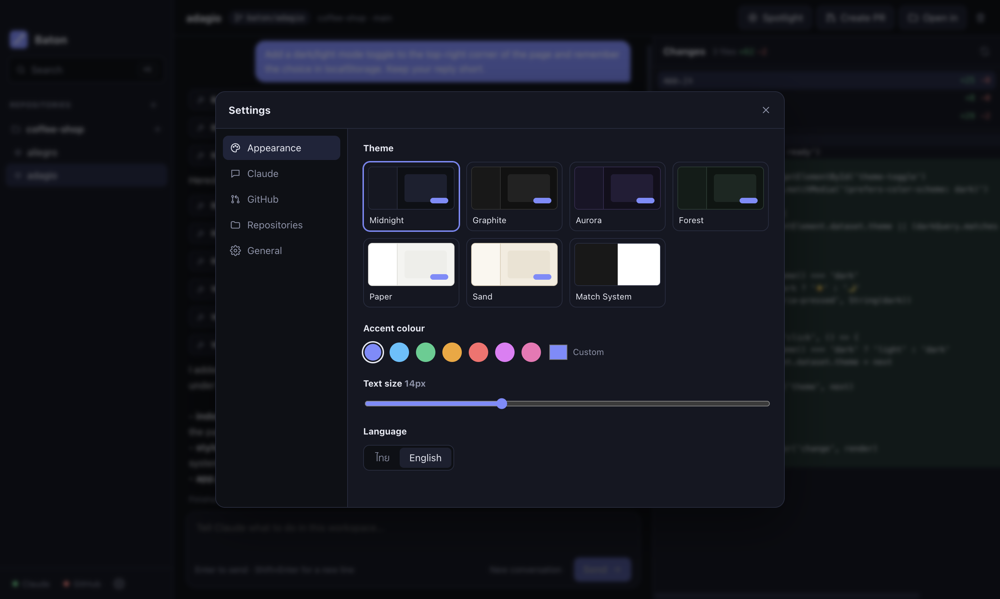
</p>

---

### ❓ FAQ

**macOS says the app is from an unidentified developer** — right-click Baton, choose Open, then Open again. Or go to System Settings → Privacy & Security and press Open Anyway.

**Windows SmartScreen shows a warning** — press More info, then Run anyway.

**Claude will not run commands (tests, npm install)** — by default it may only edit files. Change it in Settings → Claude → "Everything" (only for repositories you trust).

**Spotlight says the repository folder has uncommitted changes** — Baton never touches a folder with unfinished work. Commit or stash it first.

**Where does my code go?** — It stays on your computer. Baton only runs the local Claude Code and `gh`; data leaves your machine the way those two tools normally send it (to Claude and to GitHub).

**Where are workspaces kept?** — `~/Baton/workspaces/<repo>/<name>`. Change it in Settings → General.

---

### 🛠️ Build it yourself (for developers)

```bash
npm install
npm run dev          # run the app with hot reload
npm test             # git / Spotlight tests
npm run typecheck
./build_mac.sh       # → dist/Baton-macOS.dmg
build_windows.bat    # → dist/Baton-Windows-Setup.exe, dist/Baton-Windows-Portable.zip
npm run screenshots  # retake the README screenshots from the real app
```

Layout: `src/main` (Electron: git, GitHub, Claude) · `src/renderer` (React UI) · `src/shared` (types) · `tests` · `tools`

### 📄 License

[MIT](LICENSE) © 2026 Tanathip
